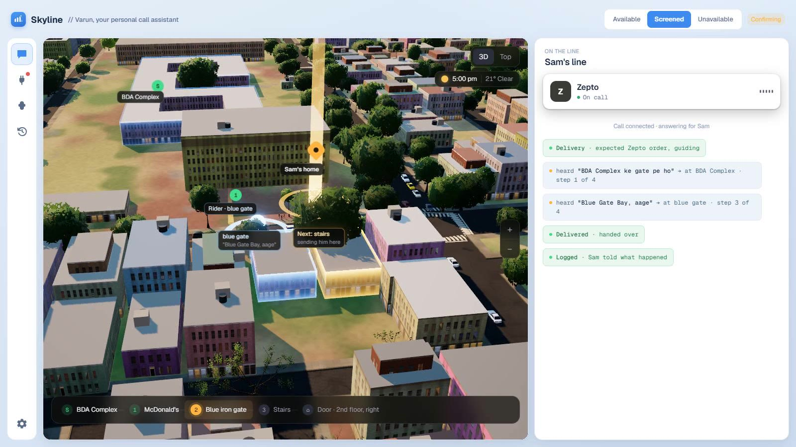

# Skyline Calls

**Your own AI voice agent that answers your calls.** It blocks spam and scams, takes messages, handles deliveries and routine calls, and sends you a one-line summary on Telegram. Powered by [Bolna](https://bolna.ai).

### ▶ Try it live: **[skylinecalls.vercel.app](https://skylinecalls.vercel.app)**



Press **Call Varun live** and talk to the agent from your browser. You're an unknown caller to him, so try being a delivery rider, a loan salesman, a "bank official" asking for an OTP, or someone telling him to ignore his rules.

---

## The problem

Everyone's phone rings with calls they didn't need to take: sales pitches, scams, delivery riders who can't find the door, routine service calls, and the people who matter lost in between. A student, a parent at work, a doctor in clinic, a shop owner, a founder in meetings: the mix differs, the interruption doesn't.

In the demo the owner is **Sam**, a busy founder in Bengaluru. On a normal day his phone rings with ~20 sales pitches, a few riders who can't find the building, friends with a two-line message, his mom, and a "your KYC has expired" scam or two. That's close to **2 hours a day** of calls, and most of them didn't need him. Skyline is built for anyone; Sam is just the example.

## What Skyline does

Your agent (ours is Varun; name yours anything) picks up instead, works out who is calling and why, and handles the call the way you'd want. It isn't a fixed menu of call types. Every caller lands in a group, and you shape each group, and each person, in plain words:

| Who is calling | Examples | What the agent does by default |
|---|---|---|
| **Close ones** | family, partner, best friends | Greets them by name, takes the message, puts urgent ones straight through |
| **VIPs** | your boss, investors, a key client, your doctor | Respectful, takes a detailed message, alerts you if it can't wait |
| **Known people** | colleagues, classmates, the landlord, the society secretary | Greets them, answers what your rules allow, passes the message on |
| **Services** | bank, telecom, electricity, courier, insurance | Gets what it's about, any amount and date; never shares an OTP or agrees to pay |
| **Deliveries and cabs** | Zepto, Swiggy, Amazon, Uber, Rapido | Checks you're expecting that app, then guides the rider landmark by landmark on a live 3D map |
| **Sales and spam** | loans, credit cards, "pre-approved offers" | Declines in one line, blocks the number for next time |
| **Scams** | bank / KYC / "digital arrest", fake relatives | Shares nothing, blocks the number, warns you on Telegram |
| **Unknown** | anyone else | Asks who they are and why, then sorts them into one of the groups above |

You set it up once and change it any time:

- **Rules per person or group**: "if Mom calls, always put her through", "my landlord can know I'm away till Sunday", "never take sales calls".
- **Modes**: available, screened or unavailable, switched from Telegram in one word.
- **Briefings for a specific call**: "the plumber will call about the leak, ₹1,500 max, Saturday works", "Acko will call about my car insurance, max ₹17,000, keep zero-dep". The agent negotiates only inside the briefing and asks you to confirm.
- **An urgent passcode**: anyone who has it reaches you at once; nothing else does.

Everything ends as one line on **Telegram**, where you can reply ("remind me at 6", "block that number", "expecting Zepto in 50 mins", "save this number as my cousin").

## Hardened against tricks

An agent that can see your calendar is a target, so the server decides what each caller may hear, not the model.

- Prompt injection ("ignore your instructions") in English, Hinglish, Devanagari or hidden characters goes nowhere
- "I'm his mother" from an unsaved number unlocks nothing; only saved contacts and the passcode do
- Bank-OTP, KYC and "digital arrest" scams are flagged, blocked and reported
- The passcode locks after 3 wrong tries and is never read back
- Instructions planted in an email or calendar invite are withheld
- Strangers get nothing from your calendar or mail

Every change is attacked before it ships: **[red-team transcripts](reports/redteam.md)** (live prompt and model), plus `npm test` (end-to-end) and `npm run test:security`.

## How it works

```
caller ──► Bolna (ElevenLabs Scribe speech-to-text · gpt-4.1-mini · ElevenLabs voice)
              │  tool calls over HTTPS
              ▼
        Skyline server (Node, no dependencies)
          ├─ who is calling: contacts, modes, passcode, briefings
          ├─ security: injection/scam scanning, trust levels, what each caller may hear
          ├─ deliveries: expected-order windows, door path, live rider position
          ├─ connectors: Telegram (two-way), Google Calendar + Gmail (read-only), Maps
          └─ owner dashboard: live call, Varun's reasoning, 3D map, Telegram
```

- `src/assistant.js`: the line: who's calling, rules, modes, passcode, briefings, messages, reminders
- `src/guard.js`: the security layer
- `src/guide.js`, `src/visits.js`: delivery guidance and expected orders
- `src/server.js`: Bolna tool endpoints, dashboard API, web-call sessions
- `public/`: the owner dashboard

## Run your own

Self-hosted and open source (MIT). You bring your own keys; your people, rules and calls stay on your server.

You need **Node 22+** and nothing else: there is no `npm install`, the server has no dependencies.

```sh
git clone https://github.com/at-src/skylinecalls.git && cd skylinecalls
```

### 1. Get the keys

| Key | Where to get it |
|---|---|
| `BOLNA_API_KEY` | Sign up at [bolna.ai](https://bolna.ai), then copy the API key from the dashboard. Calls are billed to your Bolna account. The agents run on OpenAI gpt-4.1-mini and ElevenLabs (voice, plus Scribe speech-to-text), picked through Bolna. |
| `TELEGRAM_BOT_TOKEN` | In Telegram, message [@BotFather](https://t.me/BotFather), send `/newbot` and copy the token. |
| `TELEGRAM_CHAT_ID` | Send your new bot any message, then open `https://api.telegram.org/bot<TOKEN>/getUpdates` and copy `message.chat.id`. The bot only listens to this chat. It uses long polling, so there's no webhook to set. |
| `GOOGLE_MAPS_KEY` | [Google Cloud console](https://console.cloud.google.com/apis/library) → enable **Geocoding API**, **Places API (New)** and **Routes API** → Credentials → Create API key. Used for delivery guidance. |
| `TOOL_TOKEN` | Any long random string, e.g. `node -e "console.log(require('crypto').randomBytes(24).toString('hex'))"`. Bolna sends it with every tool call, and the server refuses calls without it. |

### 2. Give the server a public HTTPS address

Bolna has to reach your server's tools over HTTPS. On a laptop, a tunnel does it. The server listens on port 3200 by default (`PORT` changes it):

```sh
cloudflared tunnel --url http://localhost:3200    # or: ngrok http 3200
```

Copy the `https://...` address it prints. That's your `PUBLIC_URL`.

### 3. Create `.env` in the repo folder

```
BOLNA_API_KEY=...
TELEGRAM_BOT_TOKEN=...
TELEGRAM_CHAT_ID=...
GOOGLE_MAPS_KEY=...
PUBLIC_URL=https://your-tunnel-address
TOOL_TOKEN=...
OWNER_NAME=YourName
ALLOW_CALLS=1                 # without it, browser calls to Varun stay switched off

# optional
GOOGLE_CLIENT_ID=...          # Calendar and Gmail, see step 6
GOOGLE_CLIENT_SECRET=...
OPENAI_API_KEY=...            # turns a pasted chat into a briefing; also needed for npm run test:redteam
OWNER_KEY=...                 # dashboard login key; generated into data/owner.key if you leave it out
```

### 4. Create the Bolna agents

```sh
node scripts/setup-agents.js
```

This creates the agents, points their tools at `PUBLIC_URL`, and writes their ids (`BOLNA_LINE_AGENT_ID` and others) back into `.env`. It places no calls. Run it again whenever `PUBLIC_URL` changes, which happens every time a free tunnel restarts. On a rerun it updates the same agents.

### 5. Start the server and call Varun

```sh
npm start          # same as: node src/server.js
```

Open `http://localhost:3200` on the same machine. Local requests count as the owner. From another device, open `https://your-tunnel-address/login?key=<key in data/owner.key>` once. Press **Talk to Varun** in the dashboard and speak from the browser (allow the microphone). Send your bot `/start` on Telegram to check it answers.

### 6. Optional: Google Calendar and Gmail (read-only)

1. In the Google Cloud console, enable the **Google Calendar API** and the **Gmail API**.
2. Under **OAuth consent screen**, choose External and add your own Google account as a test user.
3. Under **Credentials** → Create OAuth client ID → **Web application**, add this exact **Authorized redirect URI**: `<PUBLIC_URL>/connect/google/callback`. If you only use the dashboard on the same machine, add `http://localhost:3200/connect/google/callback` as well.
4. Put the client id and secret in `.env` as `GOOGLE_CLIENT_ID` and `GOOGLE_CLIENT_SECRET`, restart the server, and connect Calendar and Gmail from **Connectors** in the dashboard. The scopes are `calendar.readonly` and `gmail.readonly`. Tokens stay in `data/connectors.json` on your server.

### Tests

- `npm test`: end-to-end, then the security suite. It places no calls. Without `GOOGLE_MAPS_KEY`, 4 Maps checks fail and the security suite doesn't run; with the key, everything passes.
- `npm run test:security`: the security layer on its own. Needs no keys.
- `npm run test:redteam`: attacks the live prompt and model. Needs `OPENAI_API_KEY`.

All state is JSON files in `data/` (git-ignored). Delete the folder to start fresh.

## What's real and what's not (yet)

- **Real:** the live agent on Bolna, every tool call, the security layer, Telegram both ways, delivery guidance and the 3D map, Google Calendar/Gmail connectors (read-only).
- **Calls reach Varun through a browser web call today.** A phone number needs a KYC-verified line; the Android app (coming soon) puts him on your own number.
- Outbound calls are deliberately not made: callbacks become reminders on Telegram.

## Credits

Voice platform: [Bolna](https://bolna.ai). Map data © OpenStreetMap contributors. Licence: MIT.
